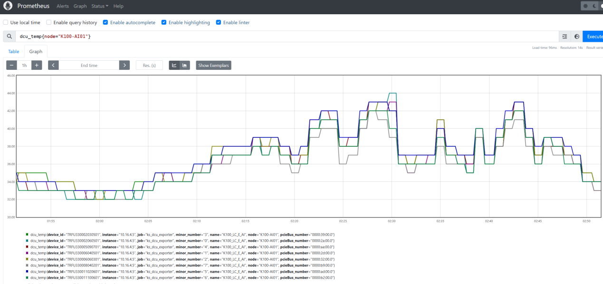
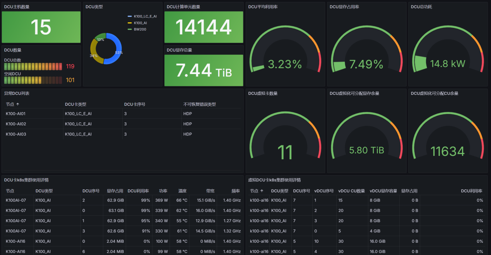

## 3.1 概述

HCU-Exporter提供 HCU/vHCU 设备的监控指标，支持 Prometheus 集成。通过 HCU-Exporter，用户可以实时监控 HCU/vHCU 的温度、功耗、显存使用率等关键指标，确保设备的健康运行。

HCU-Exporter通过 HTTP 接口暴露HCU的监控指标，默认端口为16080，默认路径为/metrics，用户可通过 http://<host>:16080/metrics 访问指标。指标以 Prometheus 文本格式提供，便于Prometheus抓取和存储。HCU-Exporter暴露的指标涵盖HCU的多个方面，指标名称和指标含义如下：

表 3.1 HCU-Exporter 监控指标

| 指标名称                   | 指标含义                                                     |
| -------------------------- | ------------------------------------------------------------ |
| hcu_temp                   | 温度                                                         |
| hcu_power_usage            | 当前功耗                                                     |
| hcu_powercap               | 功耗上限                                                     |
| hcu_sclk                   | 核心时钟频率                                                 |
| hcu_mclk                   | 内存时钟频率                                                 |
| hcu_utilizationrate        | 计算单元利用率（瞬时，HCUUse；低成本）                       |
| hcu_cu_usage               | CU 瞬时利用率（%；高成本，约 1s 窗口）                       |
| hcu_sampled_usage          | 采样窗口内 HCU 利用率（%；高成本，由 --sample-duration-ms 控制） |
| hcu_cu_sampled_usage       | 采样窗口内 CU 平均利用率（%；高成本）                        |
| hcu_wave_sampled_usage     | 采样窗口内 Wave 平均利用率（%；高成本）                      |
| hcu_se_usage               | Shader Engine 瞬时利用率（%），按 se_id 分引擎输出           |
| hcu_cu_util                | CU wave 占用周期占比（0~1；高成本，窗口同 --sample-duration-ms） |
| hcu_wave_util              | Wave 驻留占比（0~1；高成本）                                 |
| hcu_usedmemory_bytes       | 已用显存                                                     |
| hcu_memorycap_bytes        | 显存总量                                                     |
| hcu_available_memory_bytes | 可用显存（对应 hy-smi Available memory size）                |
| hcu_vram_percent           | 显存使用百分比（对应 VRAM% / HCU memory use (%)）            |
| hcu_util_percent           | HCU 利用率（对应 HCU util in last second；高成本，约 1s）    |
| hcu_temp_mem               | 显存温度（℃，对应 Temperature (Sensor mem)）                 |
| hcu_temp_board             | 板卡温度（℃；CLI 无独立 board 标签）                         |
| hcu_sensor_temp            | 传感器温度（℃）；sensor_type=edge/junction/mem/core          |
| hcu_sensor_temp_max        | 上述四路传感器温度上限（℃），GetTempBySensor+RSMI_TEMP_MAX   |
| hcu_sensor_temp_critical   | 上述四路传感器临界温度（℃），GetTempBySensor+RSMI_TEMP_CRITICAL |
| hcu_temp_edge_current      | Sensor edge 当前温度（℃），GetTempByMetric+RSMI_TEMP_CURRENT |
| hcu_temp_edge_critical     | Sensor edge 临界温度（℃）GetTempByMetric+RSMI_TEMP_CRITICAL  |
| hcu_temp_edge_emergency    | Sensor edge 紧急温度（℃），GetTempByMetric+RSMI_TEMP_EMERGENCY |
| hcu_throttle               | 降频标志（1=生效），标签 throttle_type                       |
| vhcu_temp                  | vHCU 温度                                                    |
| vhcu_sclk                  | vHCU 时钟频率                                                |
| vhcu_utilizationrate       | vHCU 利用率（VDevBusyPercent，整体 compute busy）            |
| vhcu_usedmemory_bytes      | vHCU 已用显存                                                |
| vhcu_usedmemory_percent    | vHCU 显存使用率                                              |

HCU-Exporter 暴露的指标附带标签（Labels），用于区分不同的 HCU 实例、设备或其它上下文信息。以下是标签及其含义：

表 3.2 HCU-Exporter 监控指标标签

| 标签               | 标签含义             |
| ------------------ | -------------------- |
| minor_number       | HCU设备号            |
| device_id          | HCU识别码            |
| pcieBus_number     | HCU PCIe总线号       |
| name               | HCU名称              |
| node               | HCU节点名称          |
| container          | HCU设备调用容器      |
| hcu_pod_name       | HCU设备调用Pod       |
| hcu_pod_namespace  | HCU设备调用namespace |
| block_type         | HCU ce/ue错误类型    |
| link_id            | Hylink链路ID         |
| vhcu_minor_number  | vHCU设备号           |
| vhcu_computer_unit | vHCU计算单元数量     |
| vhcu_memory_cap    | vHCU显存容量         |
| link_id            | Hylink/XHCL          |
| block_type         | ECC                  |
| se_id              | Shader Engine        |
| sensor_type        | 传感器温度           |
| throttle_type      | 降频类型             |
| dst_minor_number   | P2P 目标设备         |
| bank/field         | 显存 bank ECC        |
| level              | 性能档位             |
| pid/process_name   | 进程指标             |
| mem_type           | 分类型显存           |
| page_status        | 保留页状态           |
| chan_id            | UMC 通道             |
| direction          | XHCL 带宽方向        |
| health             | Hylink/XHCL          |

## 3.2 安装部署

本文档涉及的yaml文件可以从[社区资源中心](https://download.sourcefind.cn:65024/5/main/Kubernetes%E6%8F%92%E4%BB%B6)下载，镜像可以从[光源镜像仓库](https://developer.sourcefind.cn/servicelist)直接拉取。

### 3.2.1 宿主机环境

用户可以通过一键安装部署方式在物理机安装部署HCU-Exporter，安装过程自动完成解压和配置，安装HCU-Exporter需要保证HCU驱动已经安装。

从社区下载hcu-exporter.run安装包后，运行bash hcu-exporter.run即可完成安装部署，HCU-Exporter将安装在 /opt/hcu-exporter 目录。安装完成后，用户可通过/opt/hcu-exporter目录hcu-exporter命令启动HCU-Exporter，启动参数可以通过-h参数查看。

### 3.2.2 容器环境

以Docker为例，容器环境部署命令如下：

```
mkdir -p /etc/vdev

docker run --name hcu-exporter- -d --privileged \
--device=/dev/kfd \
--device=/dev/mkfd \
--device=/dev/dri \
-v /etc/vdev:/etc/vdev \
-v /etc/hostname:/etc/hostname \
-v /opt/hyhal:/opt/hyhal \
-p 16080:16080 image.sourcefind.cn:5000/hcu/admin/base/hcu-exporter:{relese_version}
```

其中，{relese_version}为对应组件版本号。

容器运行成功后，可通过 http://localhost:16080/metrcis 获取HCU监控指标。

### 3.2.3 Kubernetes环境

k8s集群以DaemonSet形式部署HCU-Exporter，DaemonSet部署命令如下：

```
kubectl create -f hcu-exporter.yaml
```

若需要自定义 hcu-exporter 端口，可以修改 hcu-exporter.yaml 文件中 contanierPort，Prometheus.io/port 和 service port。

```
 template:
  metadata:
    annotations:
      prometheus.io/scrape: 'true'
      prometheus.io/port: &portStr '16080'
      prometheus.io/path: 'metrics'
    labels:
      app.kubernetes.io/name: "hcu-exporter"
    name: "hcu-exporter"
  spec:
    hostNetwork: true
    serviceAccount: pod-reader
    nodeSelector:
      hygon.com/hcu: "true"
    containers:
      - image: "harbor.sourcefind.cn:5443/hcu/admin/base/hcu-exporter:v3.0.0"
        securityContext:
          privileged: true
        name: "hcu-exporter"
        imagePullPolicy: IfNotPresent
        ports:
          - name: "metrics"
            containerPort: &portInt 16080
            hostPort: *portInt
```

HCU-Exporter默认收集3.1所述全部监控指标，用户可以通过yaml环境变量" ENABLE_METRICS "指定需要采集的监控指标，如下yaml示例仅采集HCU温度与功率指标(指标名称参照3.1节，指标之间用英文逗号进行分割)。此外，指标采集间隔可以通过yaml中"PULSE"环境变量设置，以秒为单位；日志输出级别、等级、是否输出可以通过yaml中"LOG"开头的环境变换进行设置。

```
        env:
          - name: "NODE_NAME"
            valueFrom:
              fieldRef:
                fieldPath: spec.nodeName
          - name: "HCU_EXPORTER_LISTEN"
            value: *portStr
          - name: "PULSE"
            value: "10"
          # 采集成本档位：low（快）/ medium / high（含约 1s 窗口类指标，默认）
          - name: "METRICS_LEVEL"
            value: "low"
          # 采样类利用率窗口（毫秒），影响 hcu_*_sampled_usage / hcu_cu_util / hcu_wave_util；默认 1000
          - name: "SAMPLE_DURATION_MS"
            value: "1000"
          # - name: "ENABLE_METRICS"
          #   value: "hcu_temp,hcu_power_usage"
          # - name: "KUBE_CONFIG"
          #   value: "/root/.kube/config"
          - name: "LOG_THRESHOLD"
            value: "INFO"
          - name: "LOG_VERBOSE"
            value: "2"
          - name: "HYLINK_DETAIL"
            value: "false"
          - name: "LOG_OUTPUT"
            value: "true"
          # 访问 /metrics 的 IP 白名单（逗号分隔 IP 或 CIDR）；留空表示允许所有 IP
          # 示例：仅允许本机与集群内网 Prometheus 采集
          # - name: "ALLOWED_IPS"
          #   value: "127.0.0.1,10.0.0.0/8"
          - name: "ALLOWED_IPS"
            value: ""
          # 是否连接 K8S 采集 Pod 信息；设置为 "false" 可跳过 K8S 连接（裸机部署场景）
          - name: "CONNECT_K8S"
            value: "true"
          # 自定义导出指标名（内部指标名 -> 展示名），JSON 字符串；留空表示使用默认名称
          # 示例：将 hcu_ce_count 导出为 ce_count，hcu_compute_unit_count 导出为 compute_unit_count
          # - name: "METRICS_DEFINE"
          #   value: '{"hcu_ce_count":"ce_count","hcu_compute_unit_count":"compute_unit_count"}'
          - name: "METRICS_DEFINE"
            value: ""
          # 自定义指标 Label 名，JSON 字符串；全局生效，对所有包含该 Label 的指标统一重命名
          # 示例：block_type -> b_type，hcu_pod_name -> pod_name，device_id -> uuid
          # - name: "LABEL_DEFINE"
          #   value: '{"block_type":"b_type","hcu_pod_name":"pod_name","device_id":"uuid"}'
          - name: "LABEL_DEFINE"
            value: ""
```

用户可以通过查看HCU-Exporter的Pod运行情况验证HCU-Exporter是否部署成功：

```
kubectl get pod -n kube-system -owide | grep hcu-exporter
```

如下输出表示HCU-Exporter已经成功部署：

```
[root@localhost ~]# kubectl get pod -n kube-system -owide | grep hcu-exporter
hcu-exporter-6fxfx                         1/1     Running   1 (7d20h ago)   24d    192.168.100.200   worker-200   <none>           <none>
hcu-exporter-jh7tj                         1/1     Running   0               40d    192.168.100.183   worker-183   <none>           <none>
```

DaemonSet启动时已默认绑定Service，上述命令执行成功后，可以通过curl命令来查看指标：

```
curl localhost:16080/metrics
```

如下的输出示例表示HCU-Exporter已经成功部署，如下示例展示了HCU计算单元数量、可分配vHCU计算单元余量等监控指标：

```
## HELP hcu_temp hcu metrics of gauge
# TYPE hcu_temp gauge
hcu_temp{device_id="T8R1380013061601",minor_number="0",name="K100",node="hcunode3",pcieBus_number="0000:f6:00.0",hcu_pod_namespace="default",hcu_pod_name="training-job",container="worker"} 46
# HELP hcu_cu_usage HCU instantaneous CU usage rate (percent)
# TYPE hcu_cu_usage gauge
hcu_cu_usage{device_id="T8R1380013061601",minor_number="0",name="K100",node="hcunode3",pcieBus_number="0000:f6:00.0",hcu_pod_namespace="",hcu_pod_name="",container=""} 85
# HELP vhcu_utilizationrate vhcu metrics of gauge
# TYPE vhcu_utilizationrate gauge
vhcu_utilizationrate{device_id="T8R1380013061601",minor_number="0",name="K100",node="hcunode3",hcu_pod_namespace="default",hcu_pod_name="inference",container="app",vhcu_minor_number="1",vhcu_computer_unit="8",vhcu_memory_cap="17179869184"} 72
# HELP hcu_process_vram_used_bytes Process VRAM USED in bytes
# TYPE hcu_process_vram_used_bytes gauge
hcu_process_vram_used_bytes{device_id="T8R1380013061601",minor_number="0",name="K100",node="hcunode3",pcieBus_number="0000:f6:00.0",hcu_pod_namespace="default",hcu_pod_name="training-job",container="worker",pid="12345",process_name="python"} 2147483648
# HELP hcu_process_sdma_used Process SDMA USED
# TYPE hcu_process_sdma_used gauge
hcu_process_sdma_used{device_id="T8R1380013061601",minor_number="0",name="K100",node="hcunode3",pcieBus_number="0000:f6:00.0",hcu_pod_namespace="default",hcu_pod_name="training-job",container="worker",pid="12345",process_name="python"} 1024
# HELP hcu_process_cu_occupancy Process CU occupancy from ProcessHCUInfo
# TYPE hcu_process_cu_occupancy gauge
hcu_process_cu_occupancy{device_id="T8R1380013061601",minor_number="0",name="K100",node="hcunode3",pcieBus_number="0000:f6:00.0",hcu_pod_namespace="default",hcu_pod_name="training-job",container="worker",pid="12345",process_name="python"} 64
# HELP hcu_process_pasid Process address space ID (PASID) from ProcessHCUInfo
# TYPE hcu_process_pasid gauge
hcu_process_pasid{device_id="T8R1380013061601",minor_number="0",name="K100",node="hcunode3",pcieBus_number="0000:f6:00.0",hcu_pod_namespace="default",hcu_pod_name="training-job",container="worker",pid="12345",process_name="python"} 7
# HELP hcu_process_hcu_percent Process HCU(%) usage
# TYPE hcu_process_hcu_percent gauge
hcu_process_hcu_percent{device_id="T8R1380013061601",minor_number="0",name="K100",node="hcunode3",pcieBus_number="0000:f6:00.0",hcu_pod_namespace="default",hcu_pod_name="training-job",container="worker",pid="12345",process_name="python"} 87.5
# HELP hcu_process_vram_usage_rate Process VRAM usage rate percent from ProcessInfoByPid
# TYPE hcu_process_vram_usage_rate gauge
hcu_process_vram_usage_rate{device_id="T8R1380013061601",minor_number="0",name="K100",node="hcunode3",pcieBus_number="0000:f6:00.0",hcu_pod_namespace="default",hcu_pod_name="training-job",container="worker",pid="12345",process_name="python"} 25
...
```

## 3.3 集成监控

若k8s集群已经部署Prometheus，HCU-Exporter采集的指标将自动抓取到Prometheus中，用户可以通过Prometheus查询验证指标的采集情况。如下为HCU温度指标hcu_temp通过Prometheus的采集存储详情：




为方便用户进行HCU指标的可视化查看与展示，用户可通过开发者社区进行Grafana Dashboard的获取，一个示例的Dashboard展示如下。




